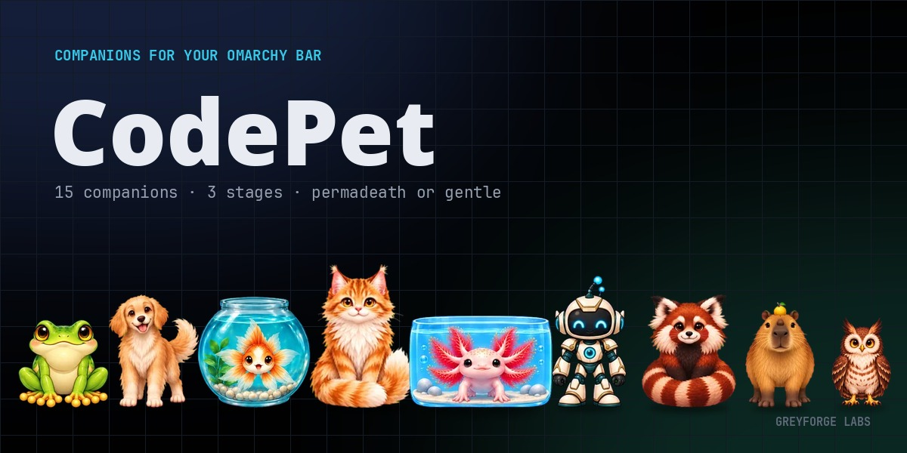
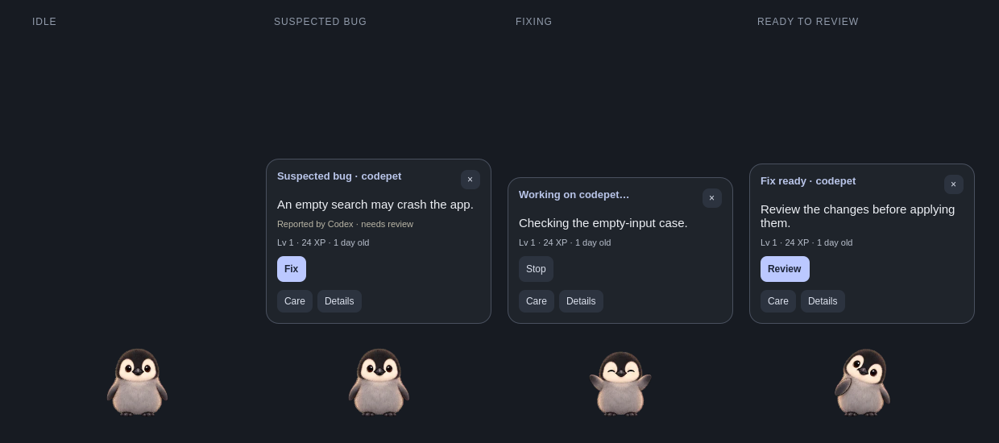

<p align="center">
  
</p>

# CodePet

**A desktop coding companion that grows through useful work.**

Your pet finds local repositories and looks for a suspected bug. Click **Fix** to
prepare a repair, then **Review** and apply it when you're satisfied. Accepted work
feeds the pet and earns XP. Play keeps it happy; naps restore its energy.

[**Download v0.4.0**](https://github.com/GreyforgeLabs/codepet/releases/tag/v0.4.0)
 · [Get started](#quick-start)
 · [Meet the pets](#meet-your-companion)
 · [Work and limits](docs/work.md)
 · [MIT license](LICENSE)

Built for **Omarchy 4 + Hyprland**. `codepet --version` prints `codepet 0.4.0`.
See the [changelog](CHANGELOG.md) and [qualification record](docs/validation.md).



*Illustrative states rendered from the real UI with synthetic data. The suspected
bug, project context and stats shown here are examples, not an actual finding.*

## Features

- **A small desktop pet:** click for its work card, drag to move, pin in place, or
  hide/show it without losing its placement. Calm mode reduces motion.
- **Find → Fix → Review:** bounded automatic checks inspect a read-only source copy.
  Fix prepares a candidate; only explicit reviewed Apply changes the original repo.
  Research and custom coding tasks are available in the advanced window.
- **Useful work feeds it:** accepted fixes fill food, research fills water, and
  builds lift mood. Each accepted job gives 20 XP once. Scouts, failed jobs and
  cancellations earn nothing. Free snacks, drinks, Play and Bath remain available.
- **Visible progress:** care percentages and bars, level, exact XP, growth progress
  and current-life age. A happy, awake pet with energy can work; after three accepted
  jobs or 45 minutes of accepted work, a two-minute nap restores energy.
- **Fifteen companions**, each with three growth stages. Change appearance without
  resetting your pet's name, age, care or growth.
- **Coding friends:** optional connections to Claude Code, Codex, OpenCode, Hermes
  and Grok observe sessions you start separately. Qualifying turns earn treats;
  giving them remains your choice. These sessions are independent of the pet's jobs.
- **One On/Off switch:** freezes care and earning and exits the desktop pet. Stop an
  active owned job before turning Off or starting a nap. Gentle mode is the default;
  Hardcore remains an explicit choice in Help.

## Meet your companion


Cat, dog, capybara, penguin, robot, iguana, spider, snake, goldfish, rabbit, turtle,
frog, owl, red panda and axolotl. Aquatic companions stay in their habitat.

## Requirements

- Omarchy 4 + Hyprland; developed against Omarchy 4.0.4's plugin API.
- Quickshell 0.3.1 (`qs`, or `CODEPET_QS`) and Qt WebP support (`qt6-imageformats` on Arch).
- For pet-owned work: **Codex 0.163.0**, signed in with an existing ChatGPT subscription;
  Linux user systemd with enforced memory/process limits, Bubblewrap and `prlimit`.
  Other Codex versions are refused by this qualified adapter. API-key billing is not used.
- Release archive: x86_64 Linux with **glibc 2.39 or later**.
- In-app updates and the Work-window launcher: **Python 3.11 or later**; updates also
  need a working user-systemd session.
- Source build: Rust 1.85 or later, Cargo and a C compiler for bundled SQLite.

**Automatic checks are enabled by default after Let's go!** When the pet is ready,
they discover repositories under `~/Projects`, `~/Work/workspaces`, `~/Code`,
`~/code`, `~/src`, `~/repos` and `~/Developer`. A scout may send selected source
context to your signed-in Codex provider and can use the network. It omits known
credentials, build caches and binary media; this is not a general secret detector.
Pause future checks with **Details → Checks off**. There are no automatic fixes,
applications, commits or pushes. See [scope and containment](docs/work.md).

Other Linux desktops remain a portability goal. Offscreen Qt tests do not qualify
actual compositor pointer/focus behavior; see [validation](docs/validation.md).

## Quick start

Download **`codepet-0.4.0-x86_64-linux.tar.gz`** and **`SHA256SUMS`** from
[the latest release](https://github.com/GreyforgeLabs/codepet/releases/latest),
then run these commands in the download directory:

```sh
sha256sum -c SHA256SUMS --ignore-missing
tar xzf codepet-0.4.0-x86_64-linux.tar.gz
cd codepet-0.4.0-x86_64-linux
packaging/omarchy/install.sh --dry-run
packaging/omarchy/install.sh
```

The archive includes the binary; nothing is compiled. The installer adds the
bar plugin, desktop pet and native review window, asks Omarchy to rescan its
plugins, and upgrades saved state with recovery backups. It never restarts your
shell or starts your pet's life. Use the installer so binary and UI versions match.
Finish or cancel active owned work and close Work before upgrading.

<details>
<summary>Build and install from source</summary>

```sh
git clone https://github.com/GreyforgeLabs/codepet
cd codepet
packaging/omarchy/install.sh --dry-run
packaging/omarchy/install.sh
```

</details>

### Update from CodePet

Open **More → Updates**. CodePet checks GitHub and offers one **Update** button when
there is a newer stable release. It verifies the download and installs it while
keeping your pet's age, XP, settings and saved work. Finish or discard active work
and pending review, then close Work first. The update continues if the plugin
reloads; reopen Updates for its result. See [update checks and recovery](docs/updates.md).

### First run

1. Click the pet on the bar and choose a companion.
2. Tap **Let's go!** to start its gentle life and show it on the desktop. Automatic
   checks become eligible when Codex is signed in and the pet is ready.
3. Click the desktop pet to open its compact card. **Details** includes the checks
   toggle. A suspected bug offers **Fix**; a finished repair offers **Review**.
4. Use **Care** for meters and free care, or **More** for sleep, pinning, Calm mode,
   Help and Memories. Optional **Helpers** connections watch other coding sessions.

The bar's left click opens Home; right click opens its small menu. Drag the desktop
pet to move it; right-click it to pin/unpin. Pinning stops wandering but still lets
you deliberately drag. Upgrades preserve existing lives, looks, XP and birth dates.

## Connect your coding apps

These optional observer connections are separate from pet-owned Codex work.
Connect is explicit. A local ready check makes no model call and earns no treat;
a real app event confirms the connection.

| App | Connection |
|---|---|
| Claude Code | Installs CodePet's local plugin through Claude's CLI; existing sessions may need `/reload-plugins`. |
| Grok CLI | Adds CodePet's own hook file. |
| OpenCode | Adds CodePet's plugin file. |
| Hermes | Adds CodePet's plugin and enables it through Hermes's CLI. |
| Codex | Adds hook groups while preserving other groups; review them yourself in `/hooks`. CodePet never grants trust. |

Claude and Hermes record plugin settings using their own CLIs. CodePet checks that
unrelated hooks and permission settings were preserved. **Stop watching** disconnects
one app. Observer hooks retain only bounded metadata, never chats or code.
See [security](docs/security.md) for the separate observer and owned-work boundaries.

Codex starts its own login shell before the observer hook. Off cannot eliminate
that shell's cost; disconnect Codex to remove CodePet's hooks from its event path.

### Uninstall

Finish or cancel any running CodePet job, finish any pending application recovery,
and close the Work window first. Closing the window alone does not stop its job. Then:

```sh
codepet-overlay quit
packaging/omarchy/uninstall.sh --dry-run
packaging/omarchy/uninstall.sh
```

The uninstaller disconnects supported apps, disables and backs up the plugin and
runtime, and preserves pet data. A silent shim may remain where another app still
references it. Do not remove a referenced shim by hand.

## Development

```sh
cargo fmt --all --check
cargo test --workspace --locked
cargo clippy --workspace --all-targets --locked -- -D warnings
cargo test --workspace --locked --features legacy-tasks
cargo clippy --workspace --all-targets --locked --features legacy-tasks -- -D warnings
python3 docs/v0.3/contracts/check_contracts.py
```

QML, integration and asset checks are in [.github/workflows/qml.yml](.github/workflows/qml.yml).
Use a throwaway `HOME` and `XDG_STATE_HOME` for experiments. The installed pet is
never a test fixture. `CODEPET_TEST_STATE=1` refuses observer Connect/Disconnect/test
jobs; it is not a substitute for isolating work-runner fixtures.

The default build's real-work controller is independent of the retired mock
pipeline. `legacy-tasks` retains non-default compatibility tests and historical
data; it is not used for real provider work. SQLite remains schema 5.

## Pet art and source-art catalog

Pets use 192×192 WebP frames extracted from GPT Image 2 source sheets. The fifteen
original concept sheets are preserved in the [art library](docs/art-library/README.md).
The extraction sources are the historical release asset
[`codepet-art-sources-v0.2.tar`](https://github.com/GreyforgeLabs/codepet/releases/download/v0.3.0/codepet-art-sources-v0.2.tar).
See [reproduction instructions](docs/pets.md#reproducing-the-frames),
[provenance](qml/assets/pets/PROVENANCE.md) and the
[raster-art decision](docs/decisions/0002-v0.2-raster-pet-art.md).

## Documentation

- [Companions](docs/pets.md) and [lifecycle](docs/lifecycle.md)
- [Architecture](docs/architecture.md) and [security](docs/security.md)
- [Bar plugin](docs/omarchy-plugin.md) and [desktop overlay](docs/desktop-overlay.md)
- [Updates and recovery](docs/updates.md)
- [Validation and remaining checks](docs/validation.md)
- [v0.3 frozen contracts](docs/v0.3/contracts/README.md)
- [Licences](docs/licenses.md) and [third-party notices](THIRD-PARTY-LICENSES.md)

The [original implementation specification](docs/implementation-spec.md) and
[v0.2 lifecycle decisions](docs/decisions/0001-v0.2-lifecycle.md) preserve design
history. Their historical task and default-mode descriptions are superseded by the
[current work loop](docs/work.md).
