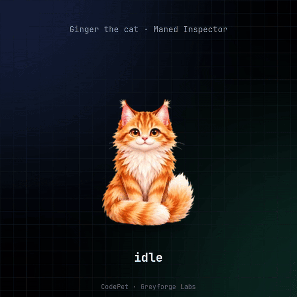
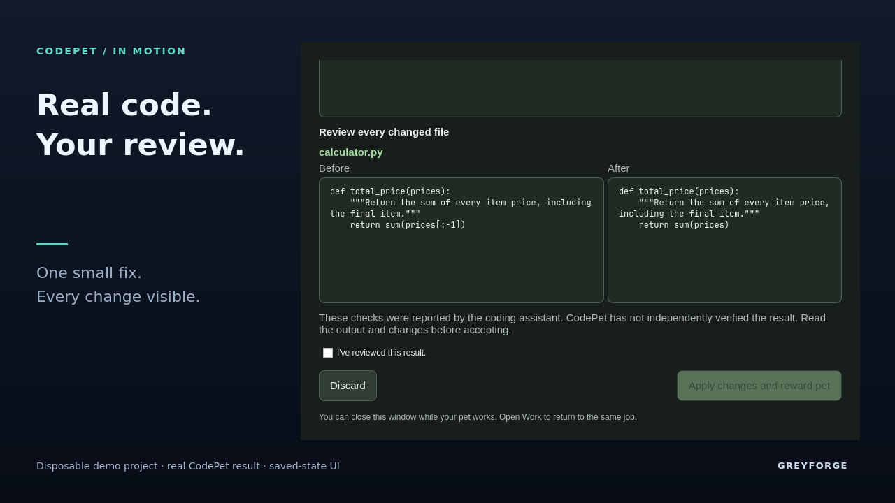
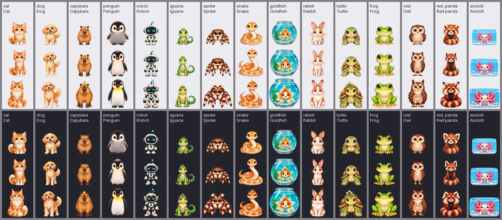
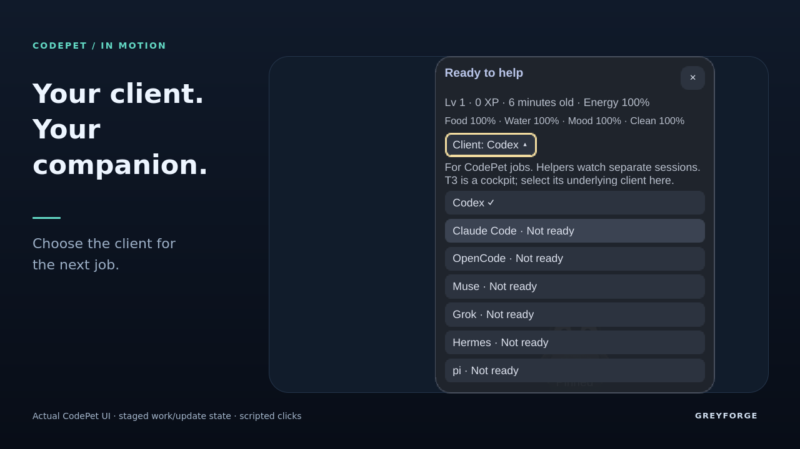

<p align="center">
  
</p>
<h1 align="center">CodePet</h1>
<p align="center"><strong>Good work. Better company.</strong><br>A little desktop companion that grows with the code you care for.</p>
<p align="center">
  <a href="https://github.com/GreyforgeLabs/codepet/releases/tag/v0.4.0"><strong>Download stable 0.4</strong></a> ·
  <a href="#quick-start">Get started</a> ·
  <a href="#see-it-work">See a real repair</a> ·
  <a href="docs/work.md">How it works</a> · <a href="LICENSE">MIT</a>
</p>

CodePet lives beside your work on **Omarchy + Hyprland**. It finds local repositories,
checks for a suspected bug, and offers a fix. You review the changes and choose what
to apply. Accepted work feeds your companion and earns XP. Between jobs, give it
some attention, let it wander, or tuck it in for a nap.

**Find → Fix → Review → Grow.** Fifteen companions. Three growth stages.

**Source status: 0.5.0, unreleased local development.** The features below describe
the 0.5 candidate. The published download remains 0.4.0; no 0.5 archive or release
video is available yet. See the [0.5 qualification record](docs/validation.md#v050-candidate-qualification-2026-10-18)
for completed checks and remaining release gates.

## In the 0.5 candidate

| A better companion | A better workflow |
| --- | --- |
| Painted care wheel with Pet, Snack, Drink, Play, Bath and Nap/Wake | Pick your coding client directly on the pet |
| Lively care pacing and playful pinned expressions | Keep each job tied to the client that started it |
| Exact XP, age, needs and energy at a glance | See setup reasons and client capability limits |
| Visible care feedback and keyboard navigation | Updates on the pet, with progress preserved |

The core is **Rust**, the interface is **native Qt Quick/QML**, and there is no
resident Rust daemon. See the [changelog](CHANGELOG.md) and [qualification](docs/validation.md).

## See it work



This still shows a deliberately seeded cart-total bug, a real prepared repair, and
three independent tests passing after Apply on the preceding development build.
The saved review was replayed for the capture; Apply happened separately. It is
historical demonstration evidence, not qualification of the 0.5 candidate. The
release video will be linked after an approved release publishes it.

## Meet your companion



Cat, dog, capybara, penguin, robot, iguana, spider, snake, goldfish, rabbit, turtle,
frog, owl, red panda and axolotl. Aquatic pets bring their own habitat. Changing
appearance keeps your companion's name, age, care and growth.

Accepted fixes fill **food**, research fills **water**, and builds lift **mood**.
Each accepted job grants **20 XP once**. Snacks, drinks, Play and Bath are free
and grant no XP. Scouts and unsuccessful jobs grant nothing.

A happy, awake pet with energy can work; food and water do not need to be full.
After three accepted jobs or 45 minutes of accepted work, a two-minute nap restores
energy. Gentle mode is the default. **Help → Care tempo** offers Steady and Lively;
existing companions keep their tempo, while new Gentle starts use Lively.
Needs change with attended desktop time, without offline catch-up.

## Quick start

Download the published **`codepet-0.4.0-x86_64-linux.tar.gz`** and **`SHA256SUMS`** from
[the 0.4 release](https://github.com/GreyforgeLabs/codepet/releases/tag/v0.4.0).
In the download directory:

```sh
sha256sum -c SHA256SUMS --ignore-missing
tar xzf codepet-0.4.0-x86_64-linux.tar.gz
cd codepet-0.4.0-x86_64-linux
packaging/omarchy/install.sh --dry-run
packaging/omarchy/install.sh
```

The archive includes the binary. Installation adds the bar plugin, desktop pet and
review window, rescans plugins, and upgrades saved state with recovery backups.
It does not restart your shell or start your pet's life. Use the installer to keep
binary and UI versions together. The published archive reports `codepet 0.4.0`.
For this unreleased source candidate, `codepet --version` prints `codepet 0.5.0`.
The current source features below are not all present in the published archive.

### First run

1. Click CodePet on the bar, choose your companion, and tap **Let's go!**
2. Left-click the desktop pet for its status, care numbers and **Client** chooser.
3. A suspected bug offers **Fix**; a finished candidate offers **Review**. Only
   explicit reviewed Apply changes your original project.
4. Right-click for quick care. Drag to move; **Pin/Roam** controls wandering.
   **Care** opens full meters, and **Details** opens longer work status.

**Automatic checks are enabled after Let's go!** Bounded scouts search conventional
development folders such as `~/Projects`, `~/Code` and `~/Work/workspaces` when the
pet is ready. Selected source context can reach your provider, and jobs can use
the network. Pause future checks with **Details → Checks off**. There are no
automatic fixes, applications, commits or pushes. [Scope and limits](docs/work.md).

### Choose a client



*Real native UI with synthetic data for the availability example. A catalog entry
does not mean its executor is configured or qualified.*

| Client for pet-owned work | Current adapter |
| --- | --- |
| **Codex 0.163.0** | Existing ChatGPT subscription; isolated commands and reviewed edits |
| **Claude Code 2.1.294** | Pro/Max access token; restricted file tools and WebSearch; no command-based tests |
| **OpenCode 1.19.0** | Pinned `opencode/big-pickle` route; isolated commands and reviewed edits |
| Muse, Grok, Hermes, pi | Detected choices with explanations; execution unavailable |

Selection is saved for the **next** job. It never starts work, changes an existing
job, resets cooldowns or falls back to another client. See [provider support](docs/providers.md).

### Keep it up to date

Open **Updates** on the pet or **More → Updates** on the bar. CodePet checks GitHub,
verifies the download, and installs the newer stable release while preserving age,
XP, settings and saved work. Finish or discard active work and pending review,
then close Work before upgrading. [Update and recovery details](docs/updates.md).

## Requirements

- **Omarchy 4 + Hyprland**, developed against Omarchy 4.0.4's plugin API.
- **Quickshell 0.3.1** (`qs`, or `CODEPET_QS`) and Qt WebP support (`qt6-imageformats` on Arch).
- **Pet-owned jobs:** a supported coding client, Linux user systemd with enforced
  memory/process limits, Bubblewrap and `prlimit`.
- Release archive: x86_64 Linux with **glibc 2.39 or later**.
- **Updates and Work launcher:** Python 3.11 or later; updates need user systemd.
- Source build: Rust 1.85 or later, Cargo and a C compiler for bundled SQLite.

<details>
<summary>Build and install from source</summary>

```sh
git clone https://github.com/GreyforgeLabs/codepet
cd codepet
packaging/omarchy/install.sh --dry-run
packaging/omarchy/install.sh
```

</details>

## Coding friends and treats

**Helpers** connects to Claude Code, Codex, OpenCode, Hermes and Grok sessions you
start separately. These observers are independent of the **Client** chosen for
pet-owned jobs. Qualifying finished turns earn treats; giving one grants **5 XP**.
The finite jar holds ten.

Connect is explicit. A local ready check makes no model call and earns no treat.
Hooks retain bounded metadata, never chats or code. Claude and Hermes manage
plugin settings through their CLIs. Codex hook entries require your review in
`/hooks`; CodePet never grants trust. [Connection and privacy details](docs/security.md).

**Off** freezes care and earning and exits the desktop pet. Stop active owned work
before turning Off or taking a nap. Codex starts its own login shell before its
observer hook; disconnect that Helpers connection to remove the hook path entirely.

### Uninstall

Finish or cancel owned work, resolve pending application recovery, and close Work.
Closing its window alone does not stop a job. Then run:

```sh
codepet-overlay quit
packaging/omarchy/uninstall.sh --dry-run
packaging/omarchy/uninstall.sh
```

Uninstall disconnects supported apps, backs up the plugin/runtime, and preserves
pet data. A silent shim may remain while a client still references it.

## Development

```sh
cargo fmt --all --check
cargo test --workspace --locked
cargo clippy --workspace --all-targets --locked -- -D warnings
cargo test --workspace --locked --features legacy-tasks
cargo clippy --workspace --all-targets --locked --features legacy-tasks -- -D warnings
python3 docs/v0.3/contracts/check_contracts.py
```

[QML CI](.github/workflows/qml.yml) covers offscreen interactions, models, integrations
and assets. Use disposable `HOME` and `XDG_STATE_HOME`; the installed pet is never a
test fixture. Schema 6 preserves lives/history with a migration backup; older
binaries refuse it. The retired `legacy-tasks` pipeline is non-default compatibility
code; real jobs use the current work controller.

## Art and documentation

Pet frames come from GPT Image 2 source sheets with reproducible extraction and
recorded provenance. Explore the [art library](docs/art-library/README.md),
[raster-art decision](docs/decisions/0002-v0.2-raster-pet-art.md), and
[source archive](https://github.com/GreyforgeLabs/codepet/releases/download/v0.3.0/codepet-art-sources-v0.2.tar).

[Companions](docs/pets.md) · [Lifecycle](docs/lifecycle.md) ·
[Architecture](docs/architecture.md) · [Security and privacy](docs/security.md) ·
[Desktop controls](docs/desktop-overlay.md) · [Validation](docs/validation.md) ·
[Licences](docs/licenses.md) · [Third-party notices](THIRD-PARTY-LICENSES.md)

Other Linux desktops remain a portability goal. The [original specification](docs/implementation-spec.md)
and [v0.3 contracts](docs/v0.3/contracts/README.md) preserve design history;
[the current work loop](docs/work.md) describes today's behavior.
