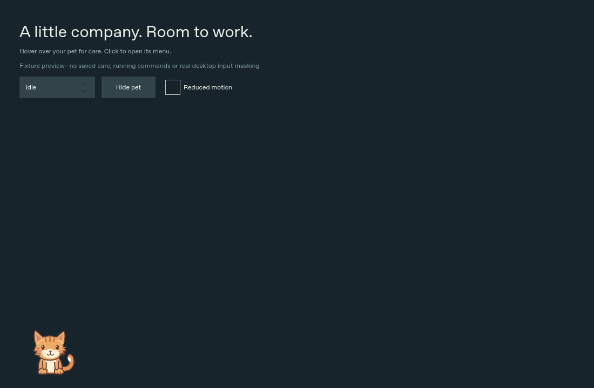
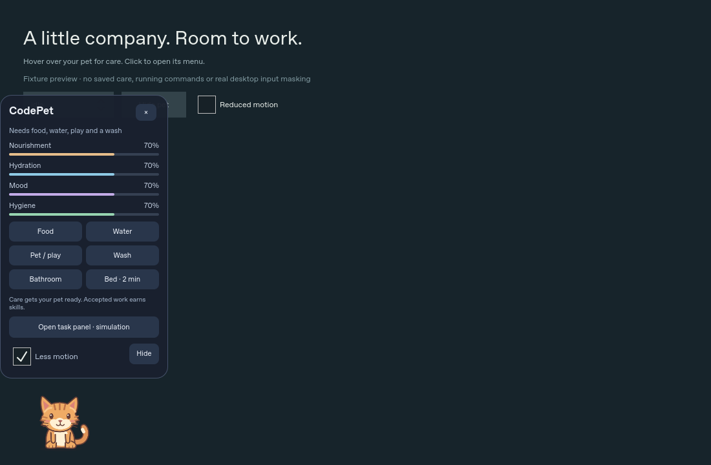

# Desktop overlay: implemented shape and validation gates

The primary presentation is a transparent pet on the desktop. It has no solid
scene backdrop or frame. Hover shows meters; selecting the pet opens compact care
controls. The pet moves only inside its screen-local surface, in short walks
separated by long pauses. Care and task state still come from Rust. No visual
scheduler launches, retries, resumes, accepts or rewards work.

## Hosts

### Omarchy / Quickshell

Build `codepet` and put it on PATH, then explicitly run:

```sh
quickshell -p qml/shell.qml
```

The entry is `qml/shell.qml`, not a file under `qml/omarchy/`: Quickshell only loads
QML inside the entry's folder, so `shared/`, `omarchy/` and `assets/` must sit below it.

This is a runnable entry file targeting Quickshell 0.3.1 APIs, not an installed
Omarchy plugin/package. No autostart or desktop settings are changed. See
[host details](../qml/omarchy/README.md) for control commands and authoritative
API references. Set `CODEPET_SCREEN` to an exact monitor name to prefer it;
otherwise the compositor's first connected screen owns the single pet.

The full-screen transparent PanelWindow uses top layer, zero exclusive zone and
keyboard focus None. Its input mask is the clipped union of the visible pet and open
menu bounds, never the scene rectangle. Decorative care props have no handler and stay
click-through. Regions are bounding boxes, not
per-pixel alpha silhouettes: small transparent corners within those boxes can
still intercept a click. Outside the regions, clicks must pass through; this
requires live compositor validation. Informational hover meters do not capture
input. Task/review UI is a separate, explicitly opened, focusable toplevel sharing
one HostAdapter. Closing it does not destroy the transport or supervisor.

Monitor removal selects a remaining screen; no screens means no overlay.
Geometry/scale changes resize the logical scene and clamp movement. These rules
are tested as policy and QML geometry, not certified on real hotplug hardware.

### Other Linux desktops

`qml/standalone/OverlayPreview.qml` is a normal window with an illustrative
background and fixture-only state. It demonstrates layout and interactions; the
background belongs to the preview, not DesktopPet. It is not connected to Rust.
`qml/standalone/Main.qml` retains the full fixture task/care test harness.

Portable shared QML has no Quickshell/Hyprland imports. There is no implemented
standalone native overlay host yet. In particular, ordinary Wayland windows
cannot promise global positioning or always-on-top behavior. X11 input-shape,
window-manager behavior and native transport remain unimplemented. Do not
advertise all-Linux overlay support based on this preview.

## Visibility and resource behavior

- One 200 ms visual scheduler (5 FPS, under the 6 FPS ceiling), no smooth global
  animations, no shell probes or idle RPC polling
- Short screen-local cosmetic steps with 8–22 second pauses; no desktop climbing,
  window-content inspection, screen capture or task discovery
- Hidden, suppressed, sleeping and reduced-motion states stop cosmetic scheduling
- Explicit hide removes pet/menu/props and the pet/menu input regions; show is explicit
- Optional suppression inputs handle trusted lock/suspend/fullscreen signals
- Automatic detection is NOT wired in this entry. An external locker is not
  observed by creating `WlSessionLock`, which would instead try to lock the session
- Until the integrator supplies trusted signals, hide CodePet explicitly before
  locking, suspending, presenting or using fullscreen apps if suppression matters
- No claim of CPU/RSS/power measurement; stated resource budgets remain targets
- No resident Rust daemon; explicit short RPCs plus the existing per-job mock
  supervisor only. Closing or hiding visual surfaces does not start/cancel work

Care props are transient presentation. Their animation completion never changes
care, readiness, sleep credit or XP. Only explicit care controls call the existing
Rust-backed API; explicit Start remains the only task launch path. Real providers
remain disabled. No sounds are imported or played.

## Live validation checklist (not performed in the cloud)

- Record compositor, Qt and Quickshell versions, scaling and monitor arrangement
- Click behind every empty area, through visible care props, and around pet/menu
  bounding boxes
- Type in another application while the pet idles, walks and opens its care menu;
  verify the overlay never steals keyboard focus
- Open tasks explicitly, type/tab/scroll/review, close and reopen; verify task state
  and an existing supervisor survive closing the window
- Check menu placement at every screen edge and on small/fractional-scale screens
- Hide/show repeatedly during care; check no invisible interactive region remains
- Unplug/replace/reorder monitors and change resolution/scaling; only one pet stays
- Bind trustworthy lock/suspend/fullscreen signals, then verify all surfaces hide
  when appropriate and that no task launches or unapproved state mutations occur
- Verify reduced motion, keyboard accessibility through the explicit task window,
  contrast, font scaling and screen reader names
- Measure idle, walk, hidden and task-window CPU/PSS, wakeups and longer-session
  growth before making resource claims

Offscreen renders and source-policy tests cannot establish these compositor facts.

## Offscreen visual evidence

These are Qt 6.8.3 fixture-preview renders, **not live desktop screenshots**. The
solid backdrop and top controls belong only to the preview host; the production
layer-shell scene is transparent. Screenshots establish artwork/layout only.



